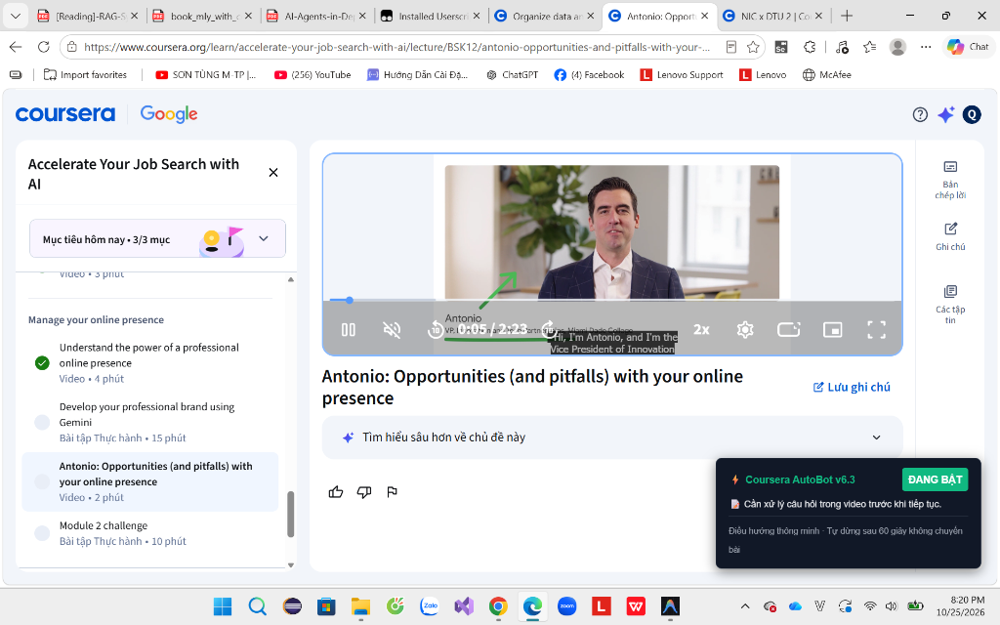

# ⚡ Coursera Auto-Learn Bot (v6.3)

[](https://www.tampermonkey.net/)
[](https://www.coursera.org)
[](https://github.com/QuanHoang05/coursera-auto-complete-bot)
[](LICENSE)

An intelligent, lightweight userscript that automates Coursera video lectures, readings, and course progression with built-in verification, fail-safe replay, and safety auto-stop.

---

## 📸 Preview

<p align="center">
  
</p>

---

## 🚀 Quick Setup

### 1. Install Tampermonkey
Install the **[Tampermonkey](https://www.tampermonkey.net/)** extension for your browser.

> [!NOTE]
> If prompted by your browser (e.g. Chrome / Brave on Manifest V3), enable **Developer Mode** and toggle **"Allow User Scripts"** under `chrome://extensions`.

### 2. Install Script

- **Direct Install**: Click **[coursera-autopilot.user.js](https://raw.githubusercontent.com/QuanHoang05/coursera-auto-complete-bot/main/coursera-autopilot.user.js)** to trigger Tampermonkey's 1-click installation modal, then click **Install**.
- **Manual Install**: Create a new userscript in Tampermonkey Dashboard, paste the contents of [`coursera-autopilot.user.js`](coursera-autopilot.user.js), and save (`Ctrl + S`).

### 3. Run
Open any lecture on [Coursera](https://www.coursera.org/learn/):
```
https://www.coursera.org/learn/<course-name>/lecture/...
```
The **⚡ Coursera AutoBot v6.3** HUD will appear at the bottom-right corner and start automating automatically.

---

## ⚡ How It Works (Based on Code Logic)

| Feature | Behavior |
| :--- | :--- |
| **Video Playback** | Sets playback to `2.0x` and mutes audio. |
| **Smart Fast-Forward** | Plays the first 60 seconds (configurable), then seeks near end (`duration - 3.5s`). |
| **Completion Verification** | Waits 4s after video ends. Verifies if Coursera registered the completed checkmark. |
| **Fail-Safe Fallback** | If Coursera rejects the skip, automatically replays from 60s or 30% mark to guarantee course progress. |
| **In-Video Prompts** | Automatically clicks *Skip / Continue* on video popups. If it's a graded assessment question, the HUD alerts: `📝 Cần xử lý câu hỏi trong video trước khi tiếp tục.` and pauses navigation. |
| **Reading & Widgets** | Auto-scrolls page, detects loaded content, clicks `Mark as complete`, and handles ungraded widgets/labs/supplements. |
| **Smart Navigation** | Clicks primary `Next item` button or resolves the next lesson from the sidebar syllabus tree. |
| **Safety Guards** | Skips graded quizzes/assignments (does not guess/submit tests). Stops on dashboard/grades pages. |
| **Timeout Protection** | Auto-terminates if URL does not change after 60 seconds to prevent runaway loops. |
| **HUD Controls** | Interactive bottom-right dark overlay with real-time status and instant **ĐANG BẬT / ĐÃ TẮT** toggle button. |

---

## ⚙️ Configuration

Modify the `CONFIG` object at the top of [`coursera-autopilot.user.js`](coursera-autopilot.user.js) to tune parameters:

```javascript
const CONFIG = {
    watchTimeBeforeSeek: 60,     // Seconds to watch before seeking
    playbackSpeed: 2.0,          // Video speed multiplier
    skipAssessments: true,       // Bypass graded assessments (true) or pause for manual submission (false)
    intervalMs: 2000,            // Bot polling loop (ms)
    nextItemTimeoutMs: 60000,    // Stop bot if stuck on same URL for 60s
    navigationRetryMs: 5000,     // Retry finding Next button every 5s
    videoCompletionCheckMs: 4000,// Delay to verify completion tick
    completeClickDelayMs: 3000   // Delay after clicking Complete button
};
```

---

## 📂 Project Structure

```text
├── assets/
│   ├── donate-qr.png            # VietQR payment code for donations
│   └── preview.png              # UI screenshot of HUD running on Coursera
├── coursera-autopilot.user.js   # Main userscript (Tampermonkey 1-click install)
├── CourseraAutoPilot.js         # Source script
├── LICENSE                      # MIT License
└── README.md                    # Project documentation
```

---

## ☕ Donate / Support

If this project helped your studies and saved you time, consider buying me a coffee! Every contribution helps maintain the script, adapt to Coursera platform changes, and develop new features.

| Bank Transfer (MB Bank) | Scan QR Code (VietQR) |
| :--- | :---: |
| 🏦 **Bank**: MB Bank (Military Commercial Joint Stock Bank)<br><br>👤 **Account Name**: `HOANG HO DINH QUAN`<br><br>💳 **Account Number**: `0383317427` |  |

---

## 📄 License

This project is licensed under the [MIT License](LICENSE).
